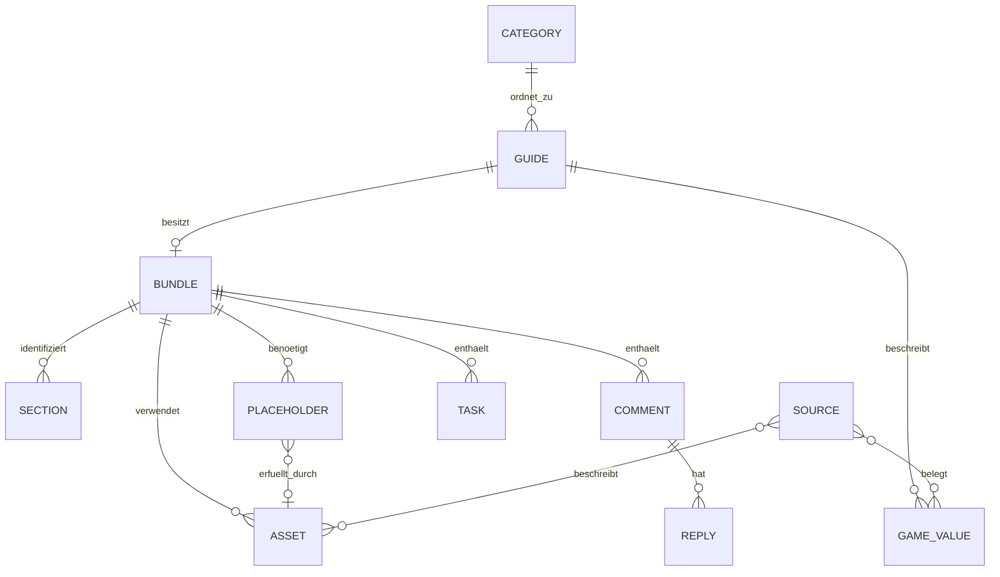

# Voidborn Academy Studio · Phase 1

Stand: 23.10.2026. Entwicklungsbranch: `dev/academy-studio-foundation`.

## Ergebnis und Architekturentscheidung

Die öffentliche VitePress-Website bleibt bestehen. Das gewünschte Studio kann später unter **https://voidborn-legion.github.io/studio/** laufen. Die Vue-Oberfläche dort ist statischer, öffentlich herunterladbarer Programmcode. Geschützt werden die Schreibaktionen und alle gegebenenfalls vertraulichen Daten durch eine echte Anmeldung und serverseitige Berechtigungsprüfung. Eine ausgeblendete Seite oder ein JavaScript-Passwort ist kein Zugriffsschutz.

GitHub Pages liefert keine Serverfunktionen. Deshalb ist zusätzlich ein kleiner serverloser Dienst erforderlich. Bevorzugte Zielarchitektur: Studio-Oberfläche im bestehenden Repository und unter `/studio/`, GitHub-App-Anmeldung und Schreib-API auf einem separaten serverlosen Endpunkt. Kein eigener dauerhaft laufender Server und kein Tunnel.

Die eigentliche Studio-HTML-Seite ist dabei nicht privat. Soll bereits ihre Auslieferung privat sein, muss sie hinter einem Auth-Gateway auf einem anderen Hosting liegen; GitHub Pages kann diese Anforderung für unsere bestehende kostenlose Organisationsseite nicht erfüllen. GitHub dokumentiert private Pages für bestimmte Enterprise-Projektseiten, nicht als kostenlose Schutzfunktion für diese Organisationsseite: [GitHub Pages visibility](https://docs.github.com/en/enterprise-cloud@latest/pages/getting-started-with-github-pages/changing-the-visibility-of-your-github-pages-site).

### Hostingvergleich

| Variante | Bewertung |
| --- | --- |
| `/studio/` auf bestehender GitHub-Seite + serverlose API | Bevorzugt nach Nutzerwunsch. Oberfläche am gewohnten Ort; echte Zugriffskontrolle im Backend. |
| ChatGPT Sites für Studio und API | Private Oberfläche und spätere eigene Plugin-Tools grundsätzlich passend. GitHub-Connector-Nutzung benötigt die Sites-Freigabeprüfung. Das erforderliche native `list_plugin_eligibility` ist in dieser Sitzung nicht verfügbar; eine funktionierende GitHub-Schreibanbindung über Sites ist daher noch nicht bestätigt. Kein Site-Projekt angelegt. |
| Separat gehostetes Studio mit Backend unter derselben Origin | Technisch einfachere Cookie-Anmeldung; andere Adresse als die Academy. Eine mögliche Alternative, wenn strikte private Auslieferung des Studios verlangt wird. |
| Nur GitHub Pages mit Anmeldemaske | Ungeeignet für Secrets oder geschützte Daten/Schreibaktionen ohne zusätzliches Backend. |

Cloudflare Workers ist ein konkreter Kandidat für die API, noch keine gebuchte oder eingerichtete Infrastruktur. Der Free-Tarif enthält derzeit begrenzte Worker- und D1-Nutzung; Last, CPU-Zeit, Datenbanknutzung und Ausfallverhalten müssen vor Betrieb geprüft werden. Kostenfreiheit ist kein unbegrenztes Versprechen. Keine kostenpflichtige Aktivierung, keine automatische Hochstufung. [Aktuelle Anbieterpreise](https://developers.cloudflare.com/workers/platform/pricing/).

## Untersuchte Ist-Struktur

- `main` zum Start: `77b0a09d8b4b14883675159f1b867ece26d28e41`.
- Öffentliche Website: VitePress 1.6.4, Vue 3, `docs/` als Website-Quellen, 12 Guides plus Übersicht.
- Kategorien: 11 Einträge in `data/categories.json`; Sidebar aus derselben Liste und Sonderseiten.
- `.pages.yml`: Guides mit Titel, Beschreibung, Autor, Datum, Veröffentlichungs- und Prüfstatus, Quellen, Rich-Text-Inhalt; zusätzliche Editor-Hilfe und Themenverwaltung.
- `.academy/manager.json`: bisherige Workflow-Konfiguration; `.academy/editor-help.md`: CMS-Hilfe. Beides bleibt unverändert.
- `.github/workflows/deploy.yml`: Push auf `main` und manueller Start; bisher erlaubte der manuelle Start theoretisch einen anderen Branch. Auf dem Entwicklungsbranch sind beide Jobs nun zusätzlich auf `refs/heads/main` begrenzt. Diese Härtung ist noch nicht in `main` aktiv.
- VitePress schließt `status: draft` aus. Öffentliche Branches sind trotzdem lesbar; private Speicherung entsteht dadurch nicht.
- Aktuelles Plugin `aion-2-academy-manager`, Version 0.1.0: ein Skill plus GitHub-App-Abhängigkeit, kein eigener Server/Editor. Gespeicherte Skill-Anweisungen wurden über Plugin Creator gelesen. Sie beschreiben Dateischreibvorgänge, verhindern aber keine direkten Fremdänderungen an GitHub und sind kein Berechtigungsfilter.
- Der bestehende Discord-Studio-Dienst wurde in dieser Phase nicht aufgerufen und nicht verändert.

### Pets-Testfall

Der tatsächliche Entwurf liegt unter `draft/pets-spezieskenntnis-migration`, nicht in `main`.

- Commit: `09919b170c8aadffa6ae67856efce23265e62ecd`.
- Datei: `docs/guides/pets.md`.
- Blob: `7f210e28cbdc5860f82d9c45a7289a6024f5148e`.
- Metadaten: `status: draft`, `review: pending`.
- Fünf Screenshot-Platzhalter mit bestehenden Studio-UUIDs, sieben Checklisteneinträge; Herkunft nennt vier ursprüngliche Studio-Kommentare. Deren vollständige Originaltexte sind aus diesem Markdown allein nicht rekonstruierbar.
- Keine Bilder vorhanden. Zahlen sind noch ungeprüft. Deshalb keine automatische Übernahme der numerischen Tabellen in die neue Spieldatenquelle.

Der Entwurf und die Platzhalterseite in `main` wurden nicht geändert. Die neue Test-Bundle-Datei referenziert den unveränderlichen Entwurfscommit; sie enthält keine zweite Kopie des Guide-Textes.

## Gemeinsame Datenbasis

Markdown bleibt die einzige Textquelle. Titel, Beschreibung, Autor, Datum, `status`, `review` und die bestehenden Guide-Quellen bleiben in der vorhandenen Frontmatter, damit Pages CMS ohne Migration weiter funktioniert. Neue Identitäten, Kommentare, Aufgaben und Bildbeziehungen werden separat geführt. IDs werden einmal vergeben und beim Umbenennen oder Verschieben erhalten.

```text
docs/guides/*.md                         bestehende Guide-Texte, unverändert
data/categories.json                    bestehende Kategorien, unverändert
data/sources.json                       gemeinsame Quellen-IDs
data/game/pets.json                     strukturierte Werte, zunächst leer
.academy/studio/catalog.json            IDs → Guide-Pfade / Kategorie-Slugs
.academy/studio/guides/<guide>.json      Abschnitte, Bilder, Platzhalter,
                                        Kommentare/Antworten und Aufgaben
packages/academy-model/schema.mjs        gemeinsames Schema als Modul
packages/academy-model/index.mjs         Validierung und Modelloperationen
packages/academy-model/repository.mjs    Dateileser für lokale Prüfungen
schemas/studio-snapshot.schema.json      exportiertes portables JSON Schema
scripts/studio-check.mjs                 Bestands- und Ankerprüfung
architecture/academy-studio-phase-1.md  dieser Architekturstand
```

Spätere Komponenten, noch nicht implementiert:

```text
studio/                                 Vue-Anwendung und Editor
services/studio-api/                     OAuth, Sitzungen, geschützte GitHub-Aktionen
packages/academy-github/                 gemeinsamer GitHub-Lese-/Schreibadapter
```

Keine private Kommentar-Datenbank parallel zum Repository anlegen. Für v1 sind ausdrücklich nicht vertrauliche Kommentare und Aufgaben im öffentlichen GitHub-Repository erlaubt. Falls private Kommentare benötigt werden, kommt ein separater privater Speicheradapter mit derselben Datenschnittstelle hinzu. Jedes Objekt hat dann genau einen zuständigen Speicher; keine öffentliche Kopie und keine automatische Zweiwege-Synchronisation. Diese private Speicherlösung ist noch nicht eingerichtet.

## Datenbeziehungen



### Guides und Kategorien

`catalog.json` bindet `guide:pets` an `docs/guides/pets.md` und `category:pets`. Die Identität bleibt bei Pfad-/Titeländerungen erhalten. Bestehende Titel/Status werden nicht dupliziert. Archivieren ist ein Lebenszyklusstatus und keine Löschung. Der spätere Veröffentlichungsadapter muss zusätzlich sichtbare Navigation und Links anpassen; ein Katalogflag allein blendet noch keinen Guide aus.

### Abschnitte und Textanker

Jeder Anker enthält Basis-Commit, Basis-Blob, Zieltyp, Abschnitts-ID und, wo sinnvoll, exaktes Textzitat mit Präfix/Suffix. Kommentare an Bilder oder Datenzeilen referenzieren stabile Objekt-IDs. Eine Zeilennummer allein genügt nicht.

Die Grundlage implementiert konservative Textsuche:

- gleicher Blob und eindeutiges Zitat: `attached`;
- anderer Blob bei noch eindeutigem Zitat: `needs-review`;
- Zitat fehlt: `stale`;
- mehrfaches Zitat: `ambiguous`.

Es gibt noch keine automatische semantische Neuzuordnung für Tabellen/Bilder. Tiptap kann später stabile Knoten-IDs im Bearbeitungsmodell verwenden; das persistierte Primärformat bleibt Markdown plus Sidecar. Kein zweites Tiptap-JSON als unabhängige Guide-Wahrheit. Explizite VitePress-Heading-Anker und Platzhalter-Markierungen müssen vor Verwendung durch den tatsächlichen Pages-CMS-Roundtrip geprüft werden.

### Screenshot-Platzhalter und Bilddateien

Platzhalter: ID, Titel, Beschreibung, Zielanker, `missing|needs-review|ready|archived`, optionale Bild-ID, Quellen und Verlauf. Die fünf existierenden Studio-UUIDs sind als `screenshot:<uuid>` wiederverwendet. Der Dateiname oder die Reihenfolge ist nicht die Identität.

Bildmetadaten: ID, Pfad, Alt-Text, Bildunterschrift, Quellen, Rechtehinweis und SHA-256. Der Uploadadapter prüft Dateityp/Signatur, Größe und Hash; SVG/HTML dürfen nicht ungeprüft als aktive Inhalte eingebettet werden. Ein Bild kann wiederverwendet werden; Ersetzen einer gemeinsamen Datei darf andere Guides nicht unbeabsichtigt ändern. Wenn nötig neue Asset-ID/Pfad statt Überschreiben erzeugen.

`assignAsset` verbindet bisher nur Metadaten und setzt `needs-review`. Erst ein verifiziert vorhandenes Bild plus atomare Markdown-/Metadatenänderung darf `ready` setzen. Die offene Übersicht blendet fertige/archivierte Platzhalter aus, während die Historie erhalten bleibt. Ein Upload oder Austausch echter Binärdateien ist noch nicht implementiert.

Bis zur Migration verweisen die neuen Platzhalter auf die alten Info-Blöcke des festgehaltenen Pets-Entwurfs. Die Blöcke bleiben als unveränderte Herkunft bestehen. Phase 2 muss diese kontrolliert in das endgültige Referenzformat überführen und doppelte Zuständigkeit vermeiden. Die Grundlage synchronisiert alte Markdown-Aufgaben nicht automatisch.

### Kommentare, Antworten und Aufgaben

Kommentare haben Anker, Text, Autor-ID, Status `open|in-progress|done`, Antworten, Zeitpunkte und Ereignisverlauf. Aufgaben haben Titel, optionale Anker, Status, Typ und Quellen. Änderungen setzen einen neuen Git-Commit; erledigte Elemente werden nicht gelöscht. Die vier ursprünglichen Studio-Kommentare wurden nicht erfunden oder als neue Kommentare nachgebildet. Die Testgrundlage enthält null Kommentare und genau eine aus der öffentlichen Entwurfs-Checkliste abgeleitete Aufgabe.

`addComment`, `replyToComment`, `setTaskStatus` und die Dashboard-Abfragen sind reine, getestete Modellfunktionen. Sie sind noch keine ChatGPT-Tools oder Browser-Endpunkte und speichern nicht automatisch ins Repository. Die spätere Servergrenze muss Autor-ID und Zeitpunkt aus vertrauenswürdiger Sitzung/Zeit gewinnen, nicht ungeprüft aus Client-Eingaben.

### Strukturierte Spieldaten

Datensatz: ID, Guide, Brett, Slot 1–9, Klasse(n), Rolle, PvE/PvP, Effekt, Einheit, Min/Max, alternative Effekt-IDs, Quellen, Region, Patch und Verifizierung. Eine Empfehlung besitzt separat Wert, Begründung und Quellen. `null` heißt unbekannt, nicht 0. Eine Stoppschwelle ist kein Spielmaximum. Verifiziert erfordert Quellen und Patch, aber auch dann muss die fachliche Prüfung tatsächlich erfolgen.

Die Schema- und Referenzprüfungen sind implementiert; `data/game/pets.json` enthält bewusst keine Zahlen. Visueller Tabelleneditor, Website-Tabelle und Filter folgen in Phase 5. Frontmatter-Quellen bleiben vorerst aus Kompatibilitätsgründen bestehen; `data/sources.json` wird von neuen Entitäten über IDs referenziert. Ein späterer Website-Renderer soll Quellen aus IDs auflösen, ohne separate Listen manuell synchronisieren zu müssen.

## Anmeldung für `/studio/`

Vorgeschlagener Ablauf, noch nicht implementiert:

1. Benutzer klickt im Studio auf „Mit GitHub anmelden“. Ein Loginfenster öffnet die serverlose API. Nur die feste erlaubte Studio-Origin wird akzeptiert.
2. Der Dienst startet GitHub-App-OAuth mit zufälligem, kurzlebigem, einmaligem `state` und PKCE S256. Callback und erlaubte Rücksprung-Origin sind fest konfiguriert; keine frei wählbaren Redirect-URLs.
3. Der OAuth-Code wird nur serverseitig getauscht. GitHub-Client-Secret, gegebenenfalls App-Schlüssel und GitHub-Zugriffstoken bleiben im Secret-Store/verschlüsselten Sitzungsspeicher. Kein Secret im Bundle, URL oder Git-Repository.
4. Die API prüft Identität und aktuellen Schreibzugriff genau auf das Academy-Repository. Eine GitHub-App wird ausschließlich für dieses Repo installiert; minimale Rechte: Contents read/write und Metadata read, gegebenenfalls Pull requests read/write. Keine Workflow-/Administrationsrechte für normale Inhaltsaktionen.
5. Weil `github.io` und die API unterschiedliche Sites sind, dürfen wir nicht auf Drittanbieter-Cookies für API-Aufrufe bauen. Das Loginfenster übergibt an die exakt erlaubte Opener-Origin ein kurzlebiges Einmalticket. Tickettausch wird an eine zweite Studio-seitige PKCE-Challenge gebunden. Das Studio hält danach nur einen kurzlebigen, undurchsichtigen eigenen API-Sitzungsschlüssel im Arbeitsspeicher; niemals einen GitHub-Token oder einen persistenten Browser-Token. Bei Neuladen wird erneut verbunden. Alternative: Studio samt API unter derselben Origin mit HttpOnly/Secure/SameSite-Cookie.
6. Jede API-Aktion prüft Sitzung, Zielrepo, Operation, Branch, Pfade, Größen und aktuelle Berechtigung. CORS nur für die feste Academy-Origin, keine Wildcards. Keine beliebigen GitHub-Proxys. Rate-Limits, Logout/Widerruf, CSRF-Schutz der Login-/Cookie-Routen, sichere `postMessage`-Origin-Prüfung, Ticket-Replay-Schutz und Idempotenz für Writes sind vor Freigabe zwingend praktisch zu testen.

Ein API-Sitzungsschlüssel im Browser-Arbeitsspeicher ist weiterhin ein temporäres Bearer-Credential. XSS-Schutz bleibt nötig: Inhalte nicht als ungefiltertes HTML ausführen, kein Markdown-`v-html` ohne Sanitizing, CSP soweit auf GitHub Pages umsetzbar. Das ist ein bewusst benannter Nachteil des gewünschten getrennten Origins. Wer keinerlei Laufzeit-Credential im Studio-JavaScript will, benötigt die Same-Origin-Backend-Variante mit HttpOnly-Cookie.

GitHub empfiehlt PKCE auch für GitHub Apps; der dokumentierte GitHub-App-Codeaustausch benötigt ein Client-Secret. Deshalb kein Secret in eine statische SPA legen: [PKCE](https://github.blog/changelog/2025-07-14-pkce-support-for-oauth-and-github-app-authentication/), [User access token flow](https://docs.github.com/en/apps/creating-github-apps/authenticating-with-a-github-app/generating-a-user-access-token-for-a-github-app). OAuth-Anmeldung ersetzt nicht die Berechtigungsprüfung: [GitHub-App best practices](https://docs.github.com/en/apps/creating-github-apps/about-creating-github-apps/best-practices-for-creating-a-github-app).

Keine GitHub-App registriert, kein Secret erzeugt, kein Login simuliert, kein neuer Dienst veröffentlicht. Die beschriebene Sitzungslösung muss mit dem ausgewählten Host verifiziert werden.

## Gemeinsamer Schreibweg und Konflikte

Studio und Manager sollen denselben Snapshot und dieselben Schema-/Referenzprüfungen verwenden. Phase 2 kann über die bestehende GitHub-App denselben öffentlichen Sidecar-Bestand bearbeiten; zusätzliche MCP-Tools sind sinnvoll, wenn zentral durchgesetzte Berechtigungen, Upload-Transaktionen und private Kommentare hinzukommen. Die aktuelle Plugin-Version wurde nicht geändert oder als „2.0 fertig“ ausgegeben.

Vorgesehene Befehle: Guide laden/speichern, Kommentar anlegen/beantworten/abschließen, Screenshot-Aufgabe anlegen, Bild zuordnen, Aufgaben abfragen und Status ändern. Eine Browser- und eine Chat-Änderung benutzen dieselben Entitäts-IDs, kein getrenntes Kommentarsystem.

Der Schreibadapter liest den aktuellen Branch-Head H und Basisbaum, validiert alle geänderten Dateien und erzeugt einen einzigen neuen Tree und Commit mit Parent H. Dann aktualisiert er den Branch ausschließlich ohne Force. Bewegt sich der Branch zwischenzeitlich, wird nicht überschrieben: neu laden, Diffs abgleichen, erneut planen. GitHubs Ref-API bietet keine frei erfundene `expected_sha`-REST-Option; `force:false` schützt durch die Fast-Forward-Regel. Ein vorhandener Connector-Wrapper kann zusätzlich einen erwarteten Head prüfen. [Git references API](https://docs.github.com/en/rest/git/refs?apiVersion=2022-11-28).

`planSave` ist implementiert und sperrt `main`, Versionskonflikte, Workflow-Pfade und Path-Traversal. Es liefert nur einen Plan. Es führt keine Netzwerktransaktion und keine Veröffentlichung aus. Dateilöschungen, Binärwrites, Archivierung und Restore sind noch nicht enthalten. Wiederholte Writes benötigen später Operation-ID/Idempotenz sowie Read-back bei unklarem Ergebnis.

Git-Historie bleibt die Versionsquelle; kein zweites Commit-Log in JSON. Ereignislisten dokumentieren fachliche Statusübergänge. Wiederherstellen wird später als neuer Commit umgesetzt, nicht durch Force-Push oder Historienverlust.

## Auswirkungen auf bestehende Komponenten

| Komponente | Jetzt | Später |
| --- | --- | --- |
| VitePress | Website-Quellen und Theme unverändert, Build bestanden | Kontrollierter Studio-Build nach `dist/studio/`; öffentliche Renderer für freigegebene Medien/Spieldaten |
| Pages CMS | `.pages.yml` unverändert | Stabile Anker und Platzhalter durch Save-Roundtrip prüfen; keine blinden Unknown-HTML-Erweiterungen |
| Guides | Keine Datei verändert; Pets-Entwurf nicht zusammengeführt | Erst beauftragte Migration in referenzierte Blöcke, Status bleibt draft |
| Workflow | Zusätzlicher nicht veröffentlichender Check-Workflow; Main-Guard nur auf Entwicklungsbranch | Nach Freigabe in main übernehmen; Veröffentlichung separat autorisieren |
| Academy Manager | Aktueller Skill untersucht, Plugin 0.1.0 bleibt installiert | Gemeinsames Modell/Operationen als nächste Skill-/Tool-Version anbinden |
| Studio | Domain-Modell und Abfragen vorhanden; keine Oberfläche | Vue-Dashboard, Editor, Auth-Adapter |

Sidecars liegen außerhalb `docs/` und werden nicht in die Website kopiert. Sie sind trotzdem im öffentlichen Repository lesbar. Vertrauliche Daten bleiben vollständig ausgeschlossen. Eine spätere statische öffentliche Tabelle darf nur explizit freigegebene Daten lesen; niemals Kommentare/Aufgaben in Client-Bundles importieren.

## Tatsächlich implementiert und geprüft

- Stabile Katalogzuordnung für 12 bestehende Guides und 11 Kategorien.
- Ein Pets-Bundle mit fünf echten Platzhalter-IDs, fünf Abschnittsbindungen und einer nicht vertraulichen Prüfaufgabe.
- JSON Schema und Ajv-Validierung, globale ID-Eindeutigkeit, Referenzprüfung und Basiswert-Prüfungen.
- Konservative Textanker-Auflösung, Dashboard-Abfragen, Aufgabenstatus, Kommentare/Antworten, Bildmetadaten-Zuordnung, konfliktgeschützte Schreibplanung.
- CLI `npm run studio:check -- --check-anchors` liest die echten Git-Objekte des festgehaltenen Pets-Entwurfs. Keine Herkunftsdaten erfunden.
- `npm run studio:test`: 9 sinnvolle Tests bestehen; `npm run build` besteht; `npm audit` meldete nach Installation keine Schwachstellen.

Nicht implementiert: Vue-Studio, Browser-Login, GitHub-Schreibadapter, echte Datei-Uploads, direkte ChatGPT-Tools, semantische Bild-/Tabellenanker, private Kommentare, visuelle Tabelle, Website-Spieldatenfilter, atomarer Markdown-Platzhalterersatz und Veröffentlichungsfreigabe-UI. Modelltests sind kein End-to-End-Nachweis dieser Funktionen.

## Nächste Phase

1. Manager auf das neue gemeinsame Sidecar-Modell vorbereiten; veröffentlichte Plugin-Änderung erst separat freigeben.
2. Für nicht vertrauliche Daten die bestehenden GitHub-Werkzeuge nutzen und Read–Edit–Write mit erwartetem Stand testen.
3. Anschließend Vue-Dashboard unter `/studio/` entwickeln; vor öffentlicher Bereitstellung die Login- und API-Host-Frage abschließen.
4. Originalkommentare des Pets-Guides nur bei konkreter Migration lesen und Sichtbarkeit jedes Kommentars entscheiden. Keine vier Kommentare aus einer zusammengefassten Checkliste rekonstruieren.

Phase 1 verändert weder Website noch aktives Plugin. Alle Änderungen bleiben auf dem Entwicklungsbranch. Eine Veröffentlichung benötigt den ausdrücklich angeforderten späteren Auftrag.
